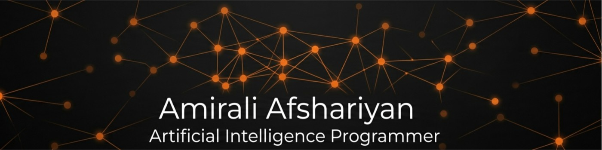

# Amirali Afshariyan

### AI Developer | Machine Learning | Computer Vision | Automation

Building intelligent solutions with Python, AI, and automation.

---

## About Me

I'm an AI enthusiast and developer focused on Machine Learning,
Deep Learning, Computer Vision, NLP, and intelligent automation.

- 🧠 Interested in AI, neural networks, and LLM applications
- 👁️ Working with image processing and computer vision
- ⚙️ Building automated workflows using n8n and AI models
- 🐍 Developing projects with Python and its data science ecosystem
- 🎮 Exploring 2D/3D game development with Ursina Engine
- 👨‍🏫 Teaching AI, programming, and automation

---

## Tech Stack

### Programming & Data Science

### Machine Learning & Deep Learning

### Computer Vision & Image Processing

### NLP, LLMs & AI Tools

### Automation & Development

### Game Development

---

## Featured Projects

### 01. AI-Powered Perfume Order Automation

An automated order-processing workflow combining n8n and an
LLM to extract and structure order information.

- Workflow automation and data processing
- LLM-powered information extraction
- Structured output for downstream workflow steps

**Technologies:** n8n · LLMs · Workflow Automation

[View Repository](https://github.com/AmiraliAfshariyan)

### 02. Handwritten Digit Recognition

A machine learning / deep learning project focused on recognizing
handwritten digits from image data.

- Image preprocessing and classification
- Model training and prediction

**Technologies:** Python · Computer Vision · Deep Learning

[View Repository](https://github.com/AmiraliAfshariyan)

### 03. Network Traffic-Based Cyberattack Detection

A machine learning project focused on analyzing network traffic
to identify potentially malicious activity.

- Network traffic data processing
- Feature analysis and classification
- Cybersecurity-focused machine learning

**Technologies:** Python · Pandas · Scikit-learn · Machine Learning

[View Repository](https://github.com/AmiraliAfshariyan)

---

## Areas of Interest

| Area | Technologies |
|---|---|
| Machine Learning | Scikit-learn, FNN, ANN |
| Deep Learning | TensorFlow, PyTorch, CNN, LSTM, GAN |
| Computer Vision | OpenCV, OCR, Image Processing |
| NLP & LLMs | NLTK, Transformers, Prompt Engineering |
| Automation | n8n, Node-RED, LLM integrations |
| Game Development | Python, Ursina Engine |

---

## GitHub Statistics

---

**Learn. Build. Automate. Innovate.**

